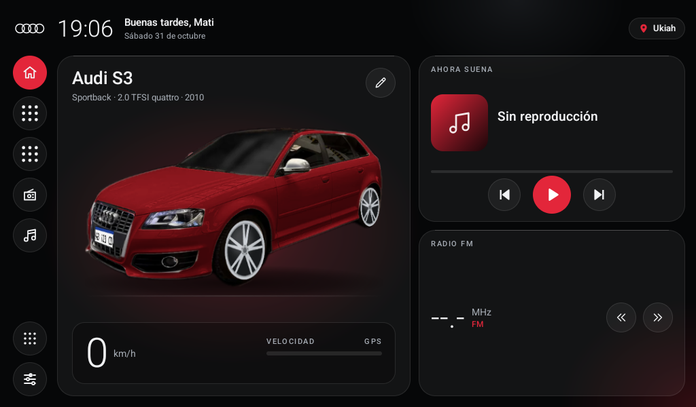
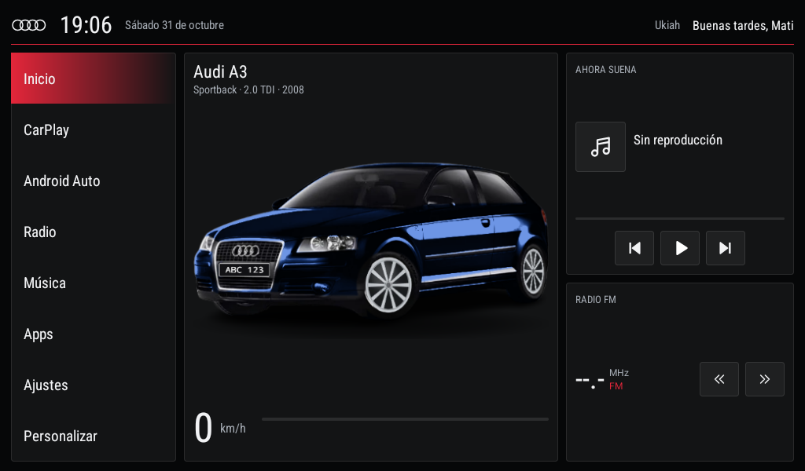
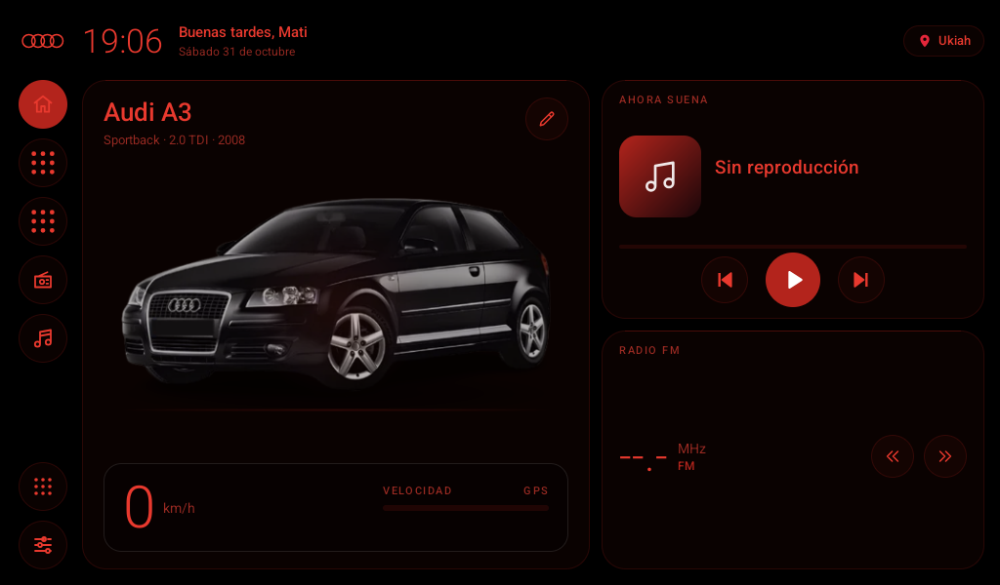

# A3 Launcher

Pantalla de inicio liviana y documentación abierta para estéreos Android chinos
(placa **JanCar UJC201 / AutoChips AC8257**, Android 9), nacida en un **Audi A3 Sportback 8P**.

*English: a lightweight, offline-only home screen for JanCar/AutoChips Android head units,
plus reverse-engineered notes on their system APIs and CAN-bus decoders. Docs are in Spanish;
contributions in English are welcome.*



| MMI clásico | Modo noche |
|---|---|
|  |  |

## Qué hay acá

- **`launcher/`**: A3 Launcher, una app HOME en Java puro (sin AndroidX), ~1 MB, que muestra hora,
  fecha, velocidad GPS, lo que suena, la radio y accesos a CarPlay / Android Auto. Elegís modelo (A3 o S3 8P),
  color, llantas, patente, saludo y diseño (liquid glass o MMI clásico), con modo noche. En español, inglés y
  portugués. No corre nada en segundo plano para no quitarle recursos a CarPlay.
- **`docs/`**: lo que se sabe de estas unidades, verificado por ADB en solo lectura:
  - [Hardware y firmware](docs/01-estereo-hardware.md)
  - [Conexión por ADB vía Wi-Fi](docs/02-conexion-adb.md)
  - [APIs de JanCar](docs/03-apis-jancar.md) (servicios, AIDL, broadcasts)
  - [CAN bus](docs/04-canbus.md) (decodificador Simple Soft, `SpAudiProtocol`)
  - [El launcher](docs/05-launcher.md), [diseño](docs/06-diseno.md), [logo de arranque](docs/07-logo-arranque.md)
  - [Packs de vehículo y perfil](docs/08-packs.md), [configurador web](docs/configurador/index.html)
  - [Otros autos y unidades](docs/vehiculos/) aportados por la comunidad

## ¿Funciona en mi estéreo?

Probado en una sola unidad: JanCar `UJC201_64`, firmware `UJC201-V1.1.04R1-240907`, 1024x600.
Otras unidades con firmware JanCar probablemente funcionen. Desde la v0.4 también abre en otras pantallas apaisadas
y en Android sin JanCar, pero sin radio ni "qué suena". Si lo probás, [contanos](CONTRIBUTING.md) con el diagnóstico
que exporta el launcher.

## Instalar

1. Bajá el APK de la última [release](../../releases/latest).
2. Copialo a un pendrive, abrilo con el administrador de archivos del estéreo e instalalo
   (o por ADB: `adb install -r -g A3Launcher-vX.Y.Z.apk`).
3. Tocá Inicio, elegí **A3 Launcher** y **Siempre**. Aceptá el permiso de ubicación (velocidad y ciudad).

Para volver al launcher original: Ajustes > Apps > A3 Launcher > Desinstalar.

> Instalás bajo tu propio riesgo. El launcher no modifica el sistema, pero el proyecto no tiene
> relación con Audi, JanCar, AutoChips ni ningún fabricante.

## Compilar

Requisitos: JDK 21 y Android SDK (compileSdk 36).

```bash
cd launcher
./gradlew assembleDebug
# APK en app/build/outputs/apk/debug/app-debug.apk
```

`targetSdk` es 25 a propósito: así los receivers del manifest siguen recibiendo los broadcasts
implícitos de JanCar. Por eso la app no puede ir a Play Store; se instala a mano.

### Personalizar

Desde la v0.2 casi todo se cambia en el estéreo: tocá el lápiz de la tarjeta del auto (saludo, patente,
modelo, color, llantas, foto propia, diseño, modo noche, recordatorios, CarPlay al dar contacto). Para cambiar un acceso de la barra lateral, mantenelo apretado.

### Personalizar tu build (animación, recursos)

Sin tocar archivos versionados: creá `launcher/private-res/` (está en `.gitignore`) con la misma
estructura que `res/` y la build usa esos recursos en lugar de los del repo. Por ejemplo:

```
launcher/private-res/values/personal.xml      <string name="greeting_name">Tu nombre</string>
launcher/private-res/drawable-nodpi/car_a3.png   foto de tu auto (sin fondo, ~460 px de ancho)
launcher/private-res/raw/audi_sting.webp         animación al dar contacto (WebP animado)
```

Si hacés un fork para otro auto, cambiá directamente los textos de `res/values/strings.xml`.

## Contribuir

Lo más útil: datos de otros autos, decodificadores CAN y unidades. Ver [CONTRIBUTING.md](CONTRIBUTING.md).

## Licencia

Copyright (C) 2026 matigodoy y contribuidores. Código bajo [GPL-3.0](LICENSE). Documentación de `docs/` bajo [CC BY 4.0](docs/LICENSE).
Audi, el logo de los cuatro aros y la animación del logo son marcas y material de AUDI AG y se
incluyen solo con fines ilustrativos; no están cubiertos por las licencias de arriba. Este proyecto
no está afiliado ni respaldado por AUDI AG.
