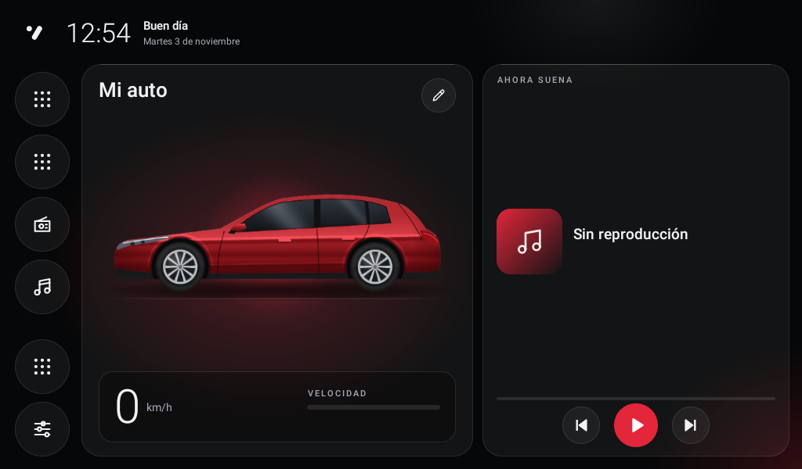
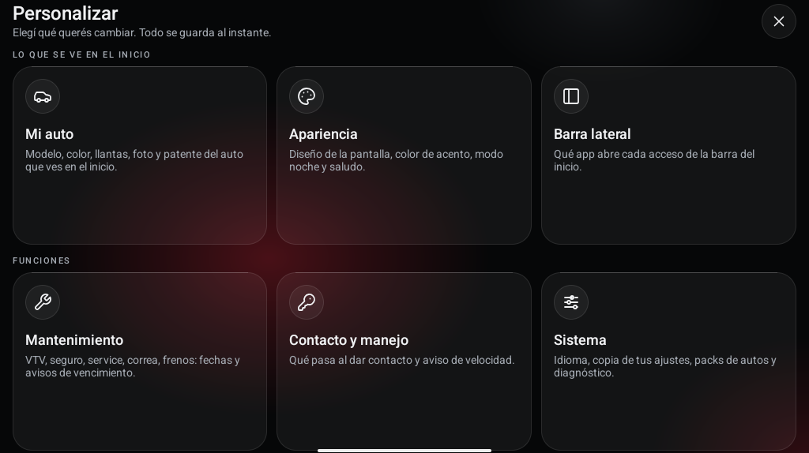

# Eclipta Launcher

Pantalla de inicio liviana y documentación abierta para estéreos Android chinos
(placa **JanCar UJC201 / AutoChips AC8257**, Android 9), nacida en un **Audi A3 Sportback 8P**.
Antes se llamaba A3 Launcher.

*English: a lightweight, offline-only home screen for JanCar/AutoChips Android head units,
plus reverse-engineered notes on their system APIs and CAN-bus decoders. Docs are in Spanish;
contributions in English are welcome.*

**¿Lo querés en tu auto?** Bajalo de la [última versión](https://github.com/matigodoy/eclipta-launcher/releases/latest)
y seguí la [guía de instalación paso a paso](docs/instalar.md). Ahí también está cómo poner la foto de tu auto.



| Clásico | Modo noche |
|---|---|
|  |  |

| Personalizar, por secciones |
|---|
|  |

## Qué hay acá

- **`launcher/`**: Eclipta Launcher, una app HOME en Java puro (sin AndroidX), ~300 KB, que muestra hora,
  fecha, velocidad GPS, lo que suena, la radio y accesos a CarPlay / Android Auto. Trae un auto dibujado, sin marca,
  con colores y llantas; tu modelo real llega con un [pack](docs/08-packs.md) por pendrive (foto, logo y animación) o con
  tu foto y su nombre. También patente, saludo y diseño (liquid glass o Clásico), con modo
  noche y avisos de mantenimiento por fecha. En español, inglés y portugués. No corre nada en segundo plano para no
  quitarle recursos a CarPlay.
- **`docs/`**: lo que se sabe de estas unidades, verificado por ADB en solo lectura:
  - [Hardware y firmware](docs/01-estereo-hardware.md)
  - [Conexión por ADB vía Wi-Fi](docs/02-conexion-adb.md)
  - [APIs de JanCar](docs/03-apis-jancar.md) (servicios, AIDL, broadcasts)
  - [CAN bus](docs/04-canbus.md) (decodificador Simple Soft, `SpAudiProtocol`)
  - [El launcher](docs/05-launcher.md), [diseño](docs/06-diseno.md), [logo de arranque](docs/07-logo-arranque.md)
  - [Packs de vehículo y perfil](docs/08-packs.md), [configurador web](docs/configurador/index.html)
  - [Otros autos y unidades](docs/vehiculos/) aportados por la comunidad

## ¿Funciona en mi estéreo?

Probado en una sola unidad: JanCar `UJC201_64`, firmware `UJC201-V1.1.04R1-240907`, 1024x600.
Otras unidades con firmware JanCar probablemente funcionen. Desde la v0.4 también abre en otras pantallas apaisadas
y en Android sin JanCar, pero sin radio ni "qué suena". Si lo probás, [contanos](CONTRIBUTING.md) con el diagnóstico
que exporta el launcher.

## Instalar

La [guía paso a paso](docs/instalar.md) lo explica para cualquiera, con capturas. En corto:

1. Bajá el APK de la [última versión](https://github.com/matigodoy/eclipta-launcher/releases/latest).
2. Copialo a un pendrive, abrilo con el administrador de archivos del estéreo e instalalo
   (o por ADB: `adb install -r -g EcliptaLauncher-vX.Y.Z.apk`).
3. Tocá Inicio, elegí **Eclipta Launcher** y **Siempre**. Si pide ubicación, aceptá (velocidad y ciudad, sin internet).

Para volver al launcher original: **Personalizar > Sistema > Desinstalar**. Está adentro de la app porque en estos
estéreos los Ajustes de Android suelen venir escondidos.

**Si venís del A3 Launcher:** cambió el id de la app (ahora `ar.com.eclipta.launcher`), así que no se actualiza encima:
es una instalación nueva y los ajustes arrancan de cero. Desinstalá el viejo para no tener dos animaciones al dar
contacto. La carpeta vieja `A3Launcher` del pendrive se sigue leyendo.

> Instalás bajo tu propio riesgo. El launcher no modifica el sistema, pero el proyecto no tiene
> relación con Audi, JanCar, AutoChips ni ningún fabricante.

## Compilar

Requisitos: JDK 21 y Android SDK (compileSdk 36).

```bash
cd launcher
./gradlew assembleDebug
# APK en app/build/outputs/apk/debug/app-debug.apk
```

`targetSdk` es 25 a propósito: así los receivers del manifest siguen recibiendo los broadcasts
implícitos de JanCar. Por eso la app no puede ir a Play Store; se instala a mano.

### Personalizar

Casi todo se cambia en el estéreo: tocá el lápiz de la tarjeta del auto y se abre un índice por secciones.

- **Mi auto** (modelo, color, llantas, foto propia, patente), **Apariencia** (diseño, acento, modo noche, saludo) y
  **Barra lateral** (qué abre cada acceso, que también se cambia manteniéndolo apretado en el inicio, y botones grandes o
  normales) muestran el auto al
  lado de las opciones.
- **Mantenimiento** (fechas y avisos), **Contacto y manejo** (animación, app que se abre al dar contacto, alerta de
  vencimientos, aviso de velocidad), **Sistema** (idioma, copia de los ajustes, packs, diagnóstico, desinstalar) y
  **Acerca de** (versión y códigos QR) ocupan toda la pantalla.

Con una foto propia y un nombre de auto, el launcher deja de usar el logo, la animación y los datos del pack: sirve
para cualquier auto. Cómo buscar y preparar la foto: [guía, "Poner la foto de tu auto"](docs/instalar.md#poner-la-foto-de-tu-auto).

### Personalizar tu build (recursos)

Sin tocar archivos versionados: creá `launcher/private-res/` (está en `.gitignore`) con la misma
estructura que `res/` y la build usa esos recursos en lugar de los del repo. Por ejemplo:

```
launcher/private-res/values/personal.xml      <string name="greeting_name">Tu nombre</string>
```

Para otro auto no hace falta un fork: alcanza con un [pack](docs/08-packs.md) o con una foto propia y el nombre del auto.

## Contribuir

Lo más útil: datos de otros autos, decodificadores CAN y unidades. Ver [CONTRIBUTING.md](CONTRIBUTING.md).

## Licencia

Copyright (C) 2026 matigodoy y contribuidores. Código bajo [GPL-3.0](LICENSE). Documentación de `docs/` bajo [CC BY 4.0](docs/LICENSE).
El repo y el APK no incluyen logos, animaciones ni fotos de marcas de autos: el auto que trae la app está
dibujado desde cero ([`scripts/make_generic_car.py`](scripts/make_generic_car.py)). Audi y las demás marcas
que se nombran son de sus dueños y aparecen solo para describir en qué autos se probó; este proyecto no
está afiliado ni respaldado por ninguno de ellos.
