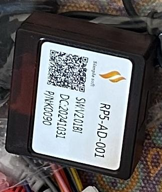

# Canbus

## Decodificador (foto de Mati)

- Marca **Simple Soft**, modelo **RP5-AD-001** ("AD" = Audi), software `SW:V2.01B1` (el "1" final no se lee del todo bien),
  fabricado el 31/10/2024 (`DC:20241031`), código de pieza `P/N K0090`.
- Se conecta al estéreo por un cable serie. La app que lo maneja en el estéreo es `com.can.activity`.

## En el estéreo

- App: `com.can.activity` v`1.0.2741.2024-08-29.0127dcc18`, `/vendor/app/ivi-canbus/ivi-canbus.apk`
  (copiada a `apks/com.can.activity/`, descompilada en `decompiled/com.can.activity/`).
- Props: `persist.sys.can_box=7`, `can_car_series=42`, `can_car_year=2`, `can_car_cfg=1`,
  `can_car_mode=1`, `canbus_icons=0`.
- Protocolo cargado (logcat): `com.autoai.canbus.audi.protocol.SpAudiProtocol`.
- JanCar registra en el log: `mCarSpeedAvailableInProtocol false`, o sea que **no llega la velocidad del auto por CAN**.
- Según la conversación, antes "About car device" mostraba **"Protocol Disconnected"** en la línea CAN
  (sin verificar por ADB; en la sesión 2 el protocolo sí cargaba y detectó la reversa).
- Corrección: al principio se pensó que el auto no tenía caja CAN. Era un error: la tiene (foto de Mati).

## Qué transmite SpAudiProtocol

Fuente: `decompiled/com.can.activity/sources/com/autoai/canbus/audi/protocol/SpAudiProtocol.java`.
Paquete con encabezado `0xAA 0x55`; solo procesa el comando **6**:

| Byte o bit | Dato |
|---|---|
| byte 3 bit 0 | ACC |
| byte 3 bit 1 | Luces (iluminación) |
| byte 3 bit 2 | Reversa (`mBackState`) |
| byte 3 bit 3 | Freno de mano |
| byte 3 bit 4 | Llave puesta |
| byte 3 bit 7 | Beep |
| byte 3 bits 2/3 | Marcha (gearShiftPosition) |
| byte 4 | Velocidad (255 = no disponible) |
| byte 6 | Brillo de faros |

**No transmite puertas ni temperatura exterior.** También soporta teclas del volante, que el auto no tiene.
Además el canbus **envía al auto la info de lo que suena** (`buildMediaInfoPackets`; en el log aparece
`HandlerMainServer.onMediaInfoChanged … Beautiful_grassland_my_home.mp3`), probablemente para el tablero.

## Pruebas en vivo (sesión 2)

| Acción de Mati | Resultado |
|---|---|
| Abrir y cerrar la puerta del conductor | Nada en el log (era lo esperable: el protocolo no la manda) |
| Poner y sacar el freno de mano | Nada visible en el log ni en los broadcasts (no se registra en el log, o el auto no lo manda) |
| Reversa | La cámara (`com.jancar.hd2cam`) se abre **por el cable de reversa** a las 21:01:59.5, y el canbus la detecta 0,9 s después (`RadarBase.doReverse … bState=true`) |
| Luces | No se llegó a probar |

## Conclusión

La velocidad del launcher sale del **GPS** (JanCar IGpsCallback). Por este protocolo **no se puede**
mostrar la temperatura exterior ni las puertas.

## Pendiente

Ver cómo `com.can.activity` reenvía estos datos a `com.jancar.services` (CarManager /
`com.jancar.services.action.car`, callbacks del lado del cliente) para leer freno de mano, luces y
reversa desde el launcher.

Preguntas abiertas: ¿el freno de mano llega pero no se registra en el log, o el auto no lo manda? ¿Las luces
(iluminación) cambian el brillo del estéreo? ¿`SW V2.01BI` es actualizable? (No tocar sin el OK del dueño.)
