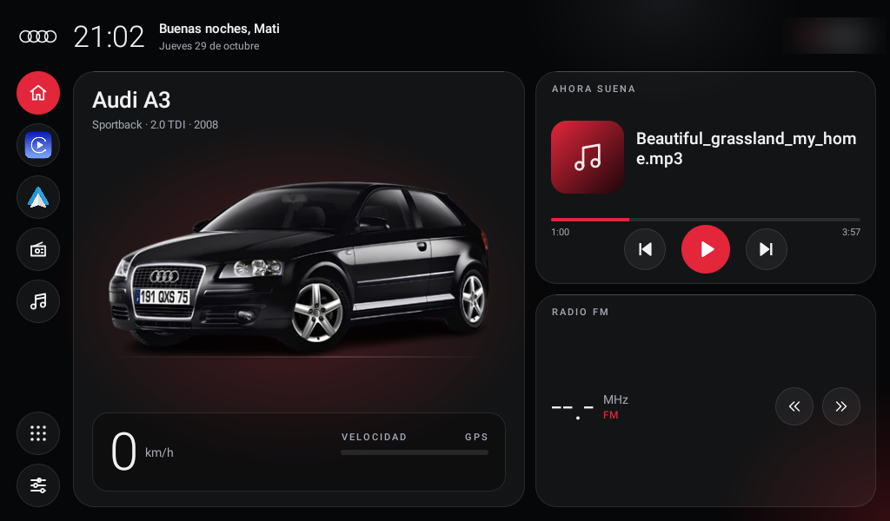

# A3 Launcher

App de inicio (HOME) propia, paquete `com.mati.a3launcher`, etiqueta "A3 Launcher".
Proyecto: `launcher/`. APKs: en [Releases](../../../releases). Instalación: ver el [README](../README.md#instalar).

## Versiones

| Versión | versionCode | Cambios | Estado |
|---|---|---|---|
| 0.1 | 1 | Primera versión (foto recortada a mano) | Reemplazada |
| 0.1.1 | 2 | Foto del auto sin fondo, de remove.bg | **Instalada en el estéreo** |
| 0.1.2 | 3 | La animación también se dispara con `QB_POWERON`; el log solo guarda cambios de media; el nombre de archivo se limpia ("a_b.mp3" pasa a "a b") | Publicada |
| 0.2.0 | 4 | Personalizar (saludo, patente, modelo A3/S3 8P, carrocería, motor, año, foto propia), CarPlay al contacto, animación opcional, barra lateral configurable. Release sin log ni permiso de internet y con R8 | Local, probada en emulador |
| 0.3.0 | 5 | Color y llantas por capas, patente sobre la foto, sombra; temas glass y MMI clásico, acentos, modo noche (siempre, atardecer, luces); aviso de velocidad; recordatorios; exportar e importar perfil y packs por pendrive; configurador web | Local, probada en emulador |
| 0.4.0 | 6 | Se adapta a otras pantallas apaisadas; funciona sin servicios JanCar (oculta la radio, GPS estándar, elegís las apps); inglés y portugués; exportar diagnóstico; menos memoria: sin doble GPS en JanCar, reloj interno más lento en reposo, libera bitmaps con CarPlay adelante | Local, probada en emulador |

## Build

- Gradle 8.13 (wrapper), AGP 8.12.0, **JDK 21**, compileSdk 36, **minSdk 28, targetSdk 25**
  (a propósito: con target < 26 los receivers del manifest siguen recibiendo los broadcasts
  implícitos de JanCar; la app se instala a mano, no va a Play Store).
- Java puro, **sin AndroidX ni librerías externas**. Firma debug (v2).
- Tamaño de la APK: unos 1,2 MB (la animación WebP ocupa 967 KB; cada pack, unos 40 KB).

## Código (`launcher/app/src/main/java/com/mati/a3launcher/`)

| Archivo | Qué hace |
|---|---|
| `MainActivity` | HOME. Header (reloj, saludo, fecha, ciudad), barra lateral, tarjeta del auto + velocidad, "Ahora suena", radio. Todo se engancha en `onStart` y se suelta en `onStop` |
| `JanCar` | Clientes Binder escritos a mano para IMedia/IMediaInfoCallback e ISystem/IGpsCallback (mismos descriptores y códigos que el SDK) |
| `AppsActivity` | Cajón de apps, 6 columnas, carga en otro hilo |
| `SplashActivity` | Animación de Audi (`res/raw/audi_sting.webp`, WebP animado de 800x600), una sola vez, se cierra sola, la salteás tocando, `taskAffinity=""` |
| `AccReceiver` | Receiver del manifest para `com.jancar.services.action.acc` (y `QB_POWERON` desde la v0.1.2); antirrebote de 20 s |
| `Profile` | Preferencias del usuario (SharedPreferences) |
| `Pack` | Pack de vehículo: `pack.json` + capas, en `assets/packs/` o `files/packs/`. Se lee solo cuando hace falta |
| `CarImage` | Hornea las capas en un solo PNG (`files/car_baked.png`) y carga lo que muestra el inicio |
| `SettingsActivity` | Pantalla Personalizar; solo vive mientras está abierta. No se abre con el auto en movimiento |
| `BaseActivity`, `Theming`, `Sun` | Paleta del usuario antes de crear vistas; modo noche con cálculo solar offline |
| `PaintMath`, `Reminders` | Cuentas puras (con tests en `app/src/test`) |
| `Launch`, `Files`, `PlateFormat` | Abrir apps y resolver accesos; buscar archivos en pendrive; formato de patente |
| `GlowBackground` | Fondo estático: #060708 + 3 óvalos con degradado radial |
| `DebugLog` | Log a `/sdcard/Android/data/com.mati.a3launcher/files/a3l-log.txt`, como máximo 200 líneas por proceso; `ENABLED=false` para apagarlo |

## Diseño ("liquid glass")

- Fondo `#060708` con brillos rojos `#E3263A` y gris `#8A93A3`. Paneles de vidrio: relleno `#0DFFFFFF`, borde
  1dp `#1FFFFFFF`, radio 24dp y línea de brillo arriba `#29FFFFFF`. Acento `#E3263A`. Texto `#F1F2F4` / `#A3A9B1`.
- Fuentes del sistema `sans-serif-light` / `sans-serif-medium` (Inter quedó afuera porque supera los 300 KB).
- Medidas en dp a 1024x600: padding 14/16, header de 56, barra lateral de 56, tarjeta del auto de 520, columna derecha con
  el resto; separaciones de 12.
- Header: logo de 4 aros (vector), hora `HH:mm` 34sp, "Buen día/Buenas tardes/Buenas noches" + nombre opcional (`greeting_name`),
  fecha en español, pastilla con la ciudad (Geocoder, cacheada, se oculta si no hay).
- Barra lateral: Inicio (rojo), CarPlay y Android Auto con **íconos reales** de las apps, Radio, Música; abajo
  Apps y Ajustes.
- Tarjeta del auto: "Audi A3", "Sportback · 2.0 TDI · 2008", foto 440dp con brillo rojo y línea de piso,
  panel de velocidad 60sp + barra 0–200 + "Sin señal GPS" si no hay fix por más de 10 s.
- "Ahora suena": carátula de 84dp (o un degradado con nota musical), título, artista, progreso,
  anterior / play-pausa / siguiente (`AudioManager.dispatchMediaKeyEvent`).
- Radio: frecuencia 44sp + MHz/kHz + banda; se guarda la última; los botones de búsqueda mandan
  next/prev si la radio es la fuente actual y, si no, abren la app de radio.

## Reglas de rendimiento (pedido de Mati: no afectar a CarPlay)

1. Nada en segundo plano: sin Service, WakeLock, alarmas ni jobs. Lo único fijo es el receiver del
   manifest (antirrebote + `startActivity`).
2. Bind de JanCar, GPS, reloj (`ACTION_TIME_TICK`), ticker de 1 s, receiver dinámico y Geocoder (cada
   10 min como mínimo): **solo entre `onStart` y `onStop`**.
3. Sin AndroidX ni librerías externas.
4. Visuales estáticos, sin blur ni animaciones; el fondo es el de la ventana; la foto está pre-escalada a 460 px;
   la carátula se escala a 84 px y la anterior se libera con recycle.
5. La animación se decodifica solo al abrir el splash y se libera en `onDestroy`; el splash se cierra en `onStop`.
6. Log en un hilo, con tope de líneas.
7. Los callbacks del Binder publican lo mínimo en el hilo principal y no redibujan si el valor no cambió.

## Mediciones en emulador (v0.4.0, API 36, 1024x600, sin JanCar)

Con `scripts/measure.sh`. **Orientativas**: falta repetirlas en el estéreo y con CarPlay real. La v0.1.2 medida era la build
debug guardada, así que parte de la mejora viene de pasar a release con R8.

| | v0.1.2 | v0.4.0 |
|---|---|---|
| PSS visible | 40 MB | 20 MB |
| PSS con otra app adelante | 46 MB | 27 MB |
| CPU en reposo (visible y en segundo plano) | 0,0 % | 0,0 % |
| Conexiones a JanCar en segundo plano | 0 | 0 |
| APK | 1,16 MB | 1,2 MB |

## Sin JanCar

`JanCar.available()` decide: si no está, no hay radio ni "qué suena" (hace falta acceso a notificaciones, que no se pide), se usa
el GPS estándar y un acceso cuya app falta abre el selector. Sin señal de contacto no hay animación ni CarPlay automático. Las
pantallas verticales no están soportadas.

## Resultados en el estéreo (sesión 2, v0.1.1)

- Instalación OK (`versionCode=2 minSdk=28 targetSdk=25`). Mati eligió "A3 Launcher" como Inicio, "Siempre".
- Arranque: `Displayed … +1s450ms`. Sin crashes.
- `bind media -> true`, `bind system -> true`. Música, radio (87.50 FM), GPS y ciudad **funcionan**.
- Reversa: la cámara se abre por encima del launcher y al sacarla vuelve sin problemas.
- ACC (21:07): al dar contacto llegaron `acc=true` (×2) y `QB_POWERON`; **la animación se mostró** y se cerró sola.
- Memoria con el launcher **visible**: PSS total 43,4 MB (Java 7,5 MB, Native 17,6 MB, gráficos 10,5 MB), CPU 0,0 %.
- **Pendiente**: medir con CarPlay o la radio adelante (que los bindings bajen a 0 y la CPU quede en 0).

## Assets

- Fotos de los autos: `assets/packs/`, ver [packs](08-packs.md). La del A3 es un **3 puertas**, no un Sportback; la del S3 sí es
  Sportback. Las capas tienen la patente tapada.
- Animación: `design/audi-logo-sting.gif` (800x600, 120 cuadros de 30 ms, fondo `#00010C`, 5,8 MB),
  convertida con `gif2webp -q 80 -m 4 -mixed` → `res/raw/audi_sting.webp` (967 KB).
- Log de diagnóstico: `/sdcard/Android/data/com.mati.a3launcher/files/a3l-log.txt`, que se apaga con `DebugLog.ENABLED`.

## Pendientes conocidos

- Instalar la última versión (firma de release: hay que desinstalar la de debug una vez).
- Medir con CarPlay adelante (**todavía no se midió en segundo plano**).
- Nombre de la emisora (RDS) y presets vía IRadio, sin usar `open()`. No se hizo: no se puede probar sin el auto y tocar la radio a ciegas es riesgoso.
- Confirmar en el auto si `getHeadLightStatus` cambia con las luces (modo noche experimental).
- Packs de A3 8V y A4 B8: faltan fotos propias.
- La temperatura exterior **no se puede** obtener con este protocolo CAN.
- Conseguir una foto de un Sportback (5 puertas).

## Ideas para próximas versiones

- Sombra suave debajo del auto (la foto de remove.bg no la tiene).
- Presets de radio, nombre RDS (`IRadioCallback.onRdsPsChanged`, sin `open()`), clima.
- Datos del canbus (freno de mano, luces) si se encuentra cómo leerlos.
- Comprobar si con CarPlay llega `onMediaChange` tipo 25.
