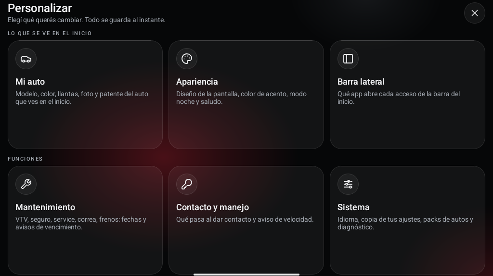
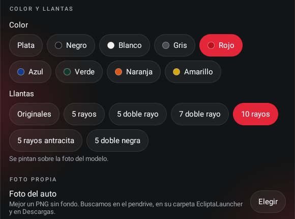
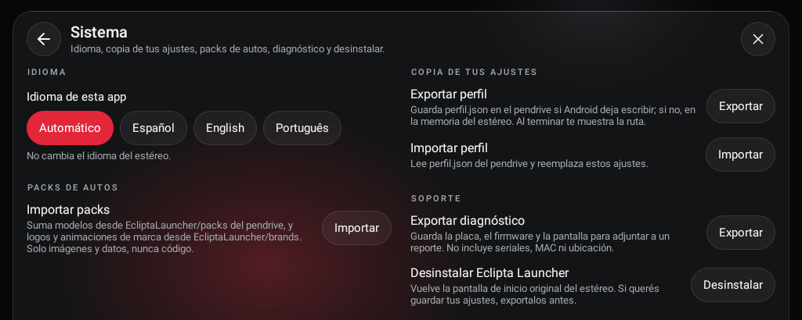

# Cómo instalar Eclipta Launcher, paso a paso

Eclipta Launcher es una pantalla de inicio para estéreos Android chinos: te muestra la hora, la velocidad, lo que
suena, la radio y la foto de tu auto, y te avisa cuando se te vence la VTV o el service. No toca nada del sistema:
si no te gusta, lo desinstalás y el estéreo queda como estaba. CarPlay y Android Auto siguen funcionando igual.

Tardás unos 10 minutos. No hace falta saber nada de computación.

## Antes de arrancar

**¿Anda en tu estéreo?** Está hecho y probado en un estéreo con placa **JanCar UJC201** (Android 9, pantalla de
1024x600), que es la que traen muchos estéreos genéricos que se venden por Mercado Libre y Amazon. En otros Android
con pantalla apaisada también abre, pero sin radio ni "qué suena". Si lo probás en otro modelo, contanos cómo te fue
(está explicado al final).

**Qué necesitás:**

- Un pendrive cualquiera.
- Una compu para bajar el archivo. También sirve el celu si tenés un adaptador para enchufarle el pendrive.

## 1. Bajá el archivo

1. Entrá a <https://github.com/matigodoy/eclipta-launcher/releases/latest>.
2. Abajo de todo, en **Assets**, hacé clic en el archivo que termina en **`.apk`**
   (por ejemplo `EcliptaLauncher-v0.5.0.apk`). Los que dicen "Source code" no te sirven.
3. Si el navegador te dice que el archivo puede ser peligroso, elegí **Conservar** o **Descargar igual**. Avisa así con
   cualquier app que no venga de Play Store.

## 2. Pasalo al pendrive

1. Enchufá el pendrive en la compu.
2. Copiá el `.apk` **suelto en el pendrive**, no adentro de una carpeta.
3. Expulsá el pendrive antes de sacarlo (clic derecho > Expulsar), así no se corrompe.

> Muchos de estos estéreos tienen Android en inglés aunque sus apps estén en castellano, así que los carteles de
> Android pueden salirte en inglés. Abajo van los dos nombres.

## 3. Instalalo en el estéreo

1. Con el auto estacionado y en contacto, enchufá el pendrive en el USB del estéreo.
2. Abrí la app de archivos del estéreo. Según el modelo se llama **Archivos**, **Administrador de archivos** o
   **File Manager**.
3. Entrá al pendrive (suele aparecer como **USB**) y tocá el archivo `EcliptaLauncher-...apk`.
4. Si te dice que **no se permiten apps de fuentes desconocidas** ("unknown apps"), tocá **Configuración**
   (**Settings**), activá **Permitir de esta fuente** (**Allow from this source**) y volvé para atrás.
5. Tocá **Instalar** (**Install**) y esperá. Cuando termine, tocá **Listo** (**Done**).

## 4. Ponelo como pantalla de inicio

1. Tocá el botón de **Inicio** (la casita) del estéreo.
2. Te va a preguntar qué app de inicio querés usar (**Select a Home app**): tocá **Eclipta Launcher** y después
   **Siempre** (**Always**).
3. Si te pide permiso de **ubicación** o de **archivos**, tocá **Permitir** (**Allow**). La ubicación es para mostrar la
   velocidad y la ciudad; funciona sin internet.

¡Listo! Ya tenés el launcher andando.

## 5. Dejalo a tu gusto

Tocá el **lápiz** de la tarjeta del auto (o el último botón de la barra de la izquierda, el de las perillas). Se abre
**Personalizar**, ordenado por secciones. Todo se guarda solo, en el momento.

- **Mi auto**: el modelo, el color, las llantas, la patente y la foto de tu auto (más abajo te explico cómo poner la tuya).
- **Apariencia**: el diseño de la pantalla, el color de los botones, el modo noche y el saludo.
- **Barra lateral**: qué app abre cada botón de la izquierda. También lo cambiás dejando apretado el botón en el inicio.
- **Mantenimiento**: cargá cuándo se vence la VTV, el seguro, el service, la correa o los frenos. Al dar contacto te
  avisa lo que esté vencido, hasta que toques **Ya lo hice**.
- **Contacto y manejo**: qué pasa al dar contacto (por ejemplo, que se abra CarPlay solo) y el aviso de velocidad.
- **Sistema**: el idioma, guardar tus ajustes en el pendrive, el diagnóstico y el botón para desinstalar.

Con el auto en movimiento, Personalizar no se abre: hacelo estacionado.

## Poner la foto de tu auto

El launcher trae fotos del Audi A3 y S3 (8P). Si tenés otro auto, le ponés una foto del tuyo y un nombre, y listo:
desaparecen el logo y la animación de Audi.

### Qué foto buscar

- **Sin fondo** (un PNG "transparente"): se ve solo el auto. Si la foto tiene fondo, vas a ver el rectángulo entero.
- **Mismo modelo, generación y color** que tu auto.
- **De tres cuartos de adelante, mirando hacia la izquierda**, como la que trae el launcher. Otro ángulo también anda,
  pero así queda mejor.
- **Grande**: por lo menos 800 píxeles de ancho.

### Cómo encontrarla en Google

1. En la compu, entrá a [Google Imágenes](https://images.google.com).
2. Buscá la marca, el modelo, los años, el color y la palabra **png**. Por ejemplo:
   - `Volkswagen Gol Trend 2015 blanco png`
   - `Peugeot 208 2021 gris png sin fondo`
   - `Toyota Hilux 2020 negra png`
3. Tocá **Herramientas** y elegí **Color > Transparente** y **Tamaño > Grande**.
4. Hacé clic en la foto que te guste para abrirla grande y después **clic derecho > Guardar imagen como…**
   Desde el celu: dejá apretada la foto y tocá **Descargar imagen**.
5. Fijate que el archivo termine en **`.png`**, **`.jpg`** o **`.webp`**. Si termina en `.avif` o `.gif`, no sirve:
   probá con otra foto.
6. Ponele un nombre fácil, por ejemplo `mi-auto.png`. Es el nombre que vas a ver en el estéreo.

> **Ojo con el fondo de cuadritos falso.** Algunas fotos tienen dibujado el cuadriculado gris y blanco que se usa para
> mostrar la transparencia. Si en el estéreo ves cuadritos alrededor del auto, la foto venía con fondo: buscá otra.

### Si la foto que te gusta tiene fondo

Le podés sacar el fondo gratis:

- **En la compu, con [remove.bg](https://www.remove.bg/es)**: subís la foto y descargás el PNG sin fondo.
  La descarga gratis alcanza.
- **En una Mac**: clic derecho sobre la imagen > **Acciones rápidas** > **Eliminar fondo**.
- **En Windows 11**: abrila con **Paint**, tocá **Quitar fondo** y guardala como PNG.
- **En el iPhone**: abrí la foto en Fotos, dejá apretado el auto hasta que se ilumine el borde, tocá **Compartir** y
  **Guardar imagen**. Después pasala a la compu.

También le podés sacar una foto a tu propio auto: de día nublado, de tres cuartos de adelante, con un fondo lo más liso
posible, y después le sacás el fondo igual que arriba.

> Las fotos de internet tienen dueño. Usala solo en tu estéreo: no la subas al proyecto ni la compartas.

### Cargarla en el estéreo

1. Copiá la foto al pendrive, suelta o adentro de una carpeta que se llame **`EcliptaLauncher`**. No la pongas en otras
   carpetas, porque no la va a encontrar.
2. Enchufá el pendrive en el estéreo.
3. Andá a **Personalizar > Mi auto**, bajá hasta **Foto propia** y tocá **Elegir**. Elegí tu foto de la lista.

   

4. Más arriba, en **Nombre del auto**, escribí cómo se llama (por ejemplo "Gol Trend"). Con foto propia y nombre,
   el launcher saca el logo y la animación de Audi.

Para volver a la foto que traía, tocá **Usar la foto del modelo**. El color y las llantas solo cambian las fotos que
trae el launcher, no la tuya.

## Si ya tenías el "A3 Launcher"

Es la misma app con otro nombre, pero el estéreo la toma como una app nueva: se instala al lado y arranca de cero.
Si querés, desinstalá el A3 Launcher viejo, así no tenés dos animaciones al dar contacto.

## Desinstalarlo

En **Personalizar > Sistema**, tocá **Desinstalar** y confirmá con **Aceptar** (**OK**). El estéreo vuelve a su
pantalla de inicio de siempre.
Si querés guardar tus ajustes para más adelante, antes tocá **Exportar perfil** con el pendrive puesto.

## Si algo no anda

1. En **Personalizar > Sistema**, tocá **Exportar diagnóstico** con el pendrive puesto. Guarda un archivo
   `diagnostico.txt` con el modelo del estéreo y la pantalla (no guarda tu ubicación ni números de serie).
2. Abrí un aviso en <https://github.com/matigodoy/eclipta-launcher/issues>, contá qué pasó y adjuntá ese archivo.

> Lo instalás bajo tu propio riesgo. El launcher no modifica el sistema, pero el proyecto no tiene relación con
> Audi, JanCar, AutoChips ni ningún fabricante.
